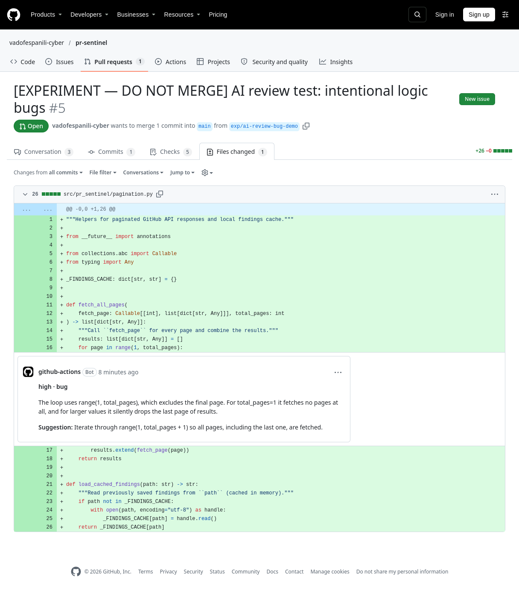
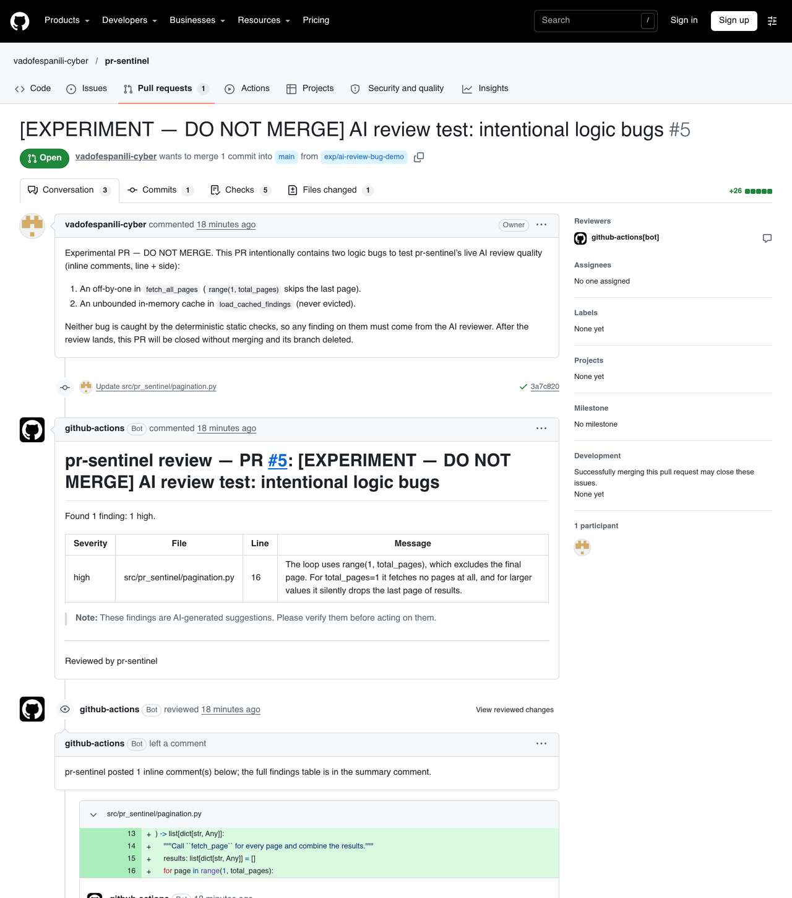

# pr-sentinel

[](https://github.com/vadofespanili-cyber/pr-sentinel/actions/workflows/ci.yml)
[](https://pypi.org/project/pr-sentinel-ai/)
[](https://www.python.org/)
[](LICENSE)

AI-powered pull request review bot — as a GitHub Action and a CLI.

Names: repository and CLI command `pr-sentinel`; PyPI package
[`pr-sentinel-ai`](https://pypi.org/project/pr-sentinel-ai/); GitHub
Marketplace action `ai-pr-sentinel`.

pr-sentinel reviews a pull request's diff with an AI model (via a
Responses-compatible API) and deterministic static checks. It finds bugs,
security issues and performance problems, posts a summary comment, adds
line-level review comments, and can also run fully locally on a patch file.



*Live review on an experimental PR: the AI reviewer caught an off-by-one
bug on line 16 that the deterministic static checks could not see.*

## See it in action

The same review as a summary comment on the pull request — one
high-severity finding, in a table:



Both screenshots come from a real review of an experimental PR that
intentionally contained two logic bugs; the reviewer caught one of them
(the off-by-one above) and missed the other (an unbounded in-memory
cache).

## Why pr-sentinel?

Code review is the bottleneck of open-source maintenance. Maintainers
drown in pull requests: every PR needs a careful read, but reviewers are
few and their time is the scarcest resource in the ecosystem. Small
projects wait days for a first review; large ones merge risky code
because nobody had time to look closely.

pr-sentinel gives every pull request a first review within seconds —
catching leaked secrets, dangerous calls and obvious bugs before a human
spends time on the diff, so maintainers can focus their review on
design and correctness instead of hunting for mistakes. It never merges,
closes or changes code; it only comments, and the human always decides.

- **Two layers:** fast static checks (leaked secrets, `eval`/`exec`,
  `shell=True`, `pickle`, huge files) plus an AI reviewer for the things
  regexes cannot see.
- **Zero-dependency core:** the package uses only the Python standard
  library. No extra packages to install, audit or keep up to date.
- **Works anywhere:** GitHub Action for automatic reviews, CLI for local
  use and CI systems other than GitHub Actions.
- **Safe by default:** API keys come from environment variables only, never
  from config files or the command line. Secret values are never echoed in
  findings or logs.

## It caught a real issue in its own workflow

While reviewing its own PyPI publish-workflow PR ([#9](https://github.com/vadofespanili-cyber/pr-sentinel/pull/9)), pr-sentinel caught a real supply-chain issue: `workflow_dispatch` would have let a run from any branch publish that branch's package contents to PyPI (medium · security). It was fixed with a job-level condition (`if: github.event_name != 'workflow_dispatch' || github.ref == 'refs/heads/main'`) plus restricting the `pypi` environment's deployment branches to `main` and `v*` tags — and the bot's re-review of the fixed commit reported "No findings."

## Quick start — GitHub Action

```yaml
# .github/workflows/pr-review.yml
name: PR review
on:
  pull_request:
    types: [opened, synchronize]

permissions:
  pull-requests: write
  contents: read

jobs:
  review:
    runs-on: ubuntu-latest
    steps:
      - uses: actions/checkout@v4
      - uses: vadofespanili-cyber/pr-sentinel@v0.2.4
        with:
          api_key: ${{ secrets.PR_SENTINEL_API_KEY }}
```

`PR_SENTINEL_API_KEY` must be a key for a Responses-compatible model
provider. The action posts one summary comment and line-level comments on
the pull request. It never merges, closes or changes code — it only
comments. The summary comment is updated in place when new commits are
pushed (it carries a hidden marker), so re-pushes do not spam the PR
with a new summary each time. Inline comments are deduplicated the same
way, and threads the bot opened for findings that are now fixed are
resolved automatically (best effort — if GitHub GraphQL is unavailable
the review still succeeds with a warning).

A full example is in [examples/github-workflow.yml](examples/github-workflow.yml).

To use a Chat Completions provider instead (OpenRouter, Ollama, Groq,
vLLM or any OpenAI-compatible endpoint), set `api_format:
chat_completions` and point `api_base_url` at that provider — see
[Other model providers](#other-model-providers-api_format) below.

## Quick start — CLI

```bash
pip install pr-sentinel-ai
export PR_SENTINEL_API_KEY="sk-..."
export GITHUB_TOKEN="ghp_..."

# Review a pull request and post the review on GitHub
pr-sentinel review --repo octocat/hello-world --pr 42

# Review a local patch file without touching GitHub
pr-sentinel review-diff --file changes.patch

# Preview without posting anything
pr-sentinel review --repo octocat/hello-world --pr 42 --dry-run

# Validate a config file
pr-sentinel check-config --config .pr-sentinel.yaml
```

The CLI exits `0` on success, `2` on config or usage errors and `3` on
API errors. By default, findings never change the exit code: a PR with
findings still exits `0`, so the review never fails your build. Set
`fail_on_severity` (or `--fail-on-severity`) to make findings at or
above a severity fail the run with exit `1` — see
[CI gate and SARIF](#ci-gate-and-sarif-output) below.

## Configuration

Optional file `.pr-sentinel.yaml` (or `.pr-sentinel.yml`) in the working
directory, or `--config PATH`. An example is in
[examples/pr-sentinel.example.yaml](examples/pr-sentinel.example.yaml).

```yaml
model: gpt-5                 # model name sent to the Responses API
severity_threshold: medium   # lowest severity to report: critical|high|medium|low
fail_on_severity: high       # optional CI gate: exit 1 if a reported finding is this severe or worse (default: no gate; "none" also disables it)
ignore_paths:                # fnmatch globs, e.g. "vendor/**", "*.min.js"
  - "docs/**"
max_files: 50                # review at most this many files per PR
max_diff_chars: 100000       # truncate larger diffs with a warning
mode: inline                 # inline = summary + line comments, summary = summary only
max_inline_comments: 20      # cap on line-level comments
api_base_url: https://api.openai.com/v1
api_format: responses        # responses (default) or chat_completions — see below
instructions: "Focus on security; ignore style nits."  # optional repo-specific guidelines for the reviewer
instructions_file: .pr-sentinel-instructions.md  # optional file with the same guidelines (max 4,000 chars; wins over `instructions`)
```

| Setting | Default |
| --- | --- |
| `model` | `gpt-5` |
| `severity_threshold` | `medium` |
| `fail_on_severity` | `None` (no gate) |
| `ignore_paths` | `[]` |
| `max_files` | `50` |
| `max_diff_chars` | `100000` |
| `mode` | `inline` |
| `max_inline_comments` | `20` |
| `api_base_url` | `https://api.openai.com/v1` |
| `api_format` | `responses` |
| `instructions` | `None` |
| `instructions_file` | `None` |

Environment variables:

| Variable | Purpose |
| --- | --- |
| `PR_SENTINEL_API_KEY` | API key for the model provider (required for AI review; without it only static checks run) |
| `GITHUB_TOKEN` | GitHub token with pull-request read/write access (required for `review`) |

### Other model providers (`api_format`)

By default pr-sentinel talks to the Responses API (`POST
{api_base_url}/responses`). Set `api_format: chat_completions` (or
`--api-format chat_completions` on `review` / `review-diff`, or the
`api_format` Action input) to use the Chat Completions API instead
(`POST {api_base_url}/chat/completions` with a standard `messages`
array). The retry/backoff, timeout, JSON parsing and prompt-injection
delimiters are identical for both formats, so any OpenAI-compatible
provider works with no new dependencies:

```yaml
# OpenRouter
api_base_url: https://openrouter.ai/api/v1
api_format: chat_completions
model: openai/gpt-4o-mini

# Ollama (local, no key needed for the model itself — set any non-empty
# PR_SENTINEL_API_KEY so the CLI enables AI review)
# api_base_url: http://localhost:11434/v1
# api_format: chat_completions
# model: llama3.1
```

An invalid `api_format` is a config error (exit `2`).

### Repo-specific instructions

`instructions` (inline string) or `instructions_file` (path to a
Markdown/text file) adds repository guidelines to the reviewer prompt,
clearly separated from the untrusted diff delimiters — for example
"this repo uses tabs", "ignore performance nits in tests", or "pay
extra attention to the payment code". The file wins over the inline
string when both are set. The total size is capped at 4,000 characters;
a missing or unreadable file, or instructions over the cap, is a config
error (exit `2`). Without either setting the prompt is byte-identical
to previous versions.

Guidelines are placed in the user message as lower-priority style and
focus preferences — never in the system prompt — and the system prompt
states explicitly that they can never override the core security
rules, the JSON output schema, or instruct the reviewer to suppress or
ignore findings. That matters because a PR author can change the repo
config inside their own PR: **repos that review untrusted external PRs
should load the config from the base branch or pass a trusted
`--config` path**, rather than reading `.pr-sentinel.yaml` from the PR
branch.

`instructions_file` must be a relative path inside the config file's
directory: absolute paths and `..` escapes are rejected as config
errors.

### Suppressing a static finding

An added line carrying `pr-sentinel: ignore` inside a comment
(`#`, `//` or `/* ... */`, case-insensitive) suppresses static-check
findings on that exact line only — for intentional fixtures such as
`eval()` in tests or a dummy token in an example:

```python
x = eval(user_input)  # pr-sentinel: ignore
```

Static checks also filter obvious placeholder secrets on their own
(`test`/`dummy`/`example`/`fake` values, `changeme`, `your_...`,
repeated characters, very short low-entropy values), while real
high-entropy secrets — genuine AWS keys, private key headers,
realistic `sk-proj-...` / `ghp_...` tokens — are still reported. The
marker must be inside a comment: the same words in a string literal do
not suppress anything. Placeholder matching is exact: a value is a
placeholder when a component of it is a placeholder word
(`ghp_test`), a placeholder word repeated or followed by digits
(`test123`), or a well-known published example value — real words that
merely end in a placeholder word (`contest`, `protest`, `latest`) are
still reported.

## CI gate and SARIF output

### Failing the build on severe findings

Set `fail_on_severity` in the config file, or pass
`--fail-on-severity` to `review` / `review-diff` (the flag wins over
the config file), or set the `fail_on_severity` Action input. Valid
values: `critical`, `high`, `medium`, `low`; `none` (or leaving it
unset) disables the gate. When the gate is on, the run exits `1` if any
*reported* finding — after `severity_threshold` and `ignore_paths`
filtering — meets or exceeds the threshold; otherwise it exits `0`.
The review is always posted and `--json-out` / `--sarif-out` are always
written before the gate exits `1`, so CI still has the full report.

Note the interaction with `severity_threshold`: the gate only sees
findings that were reported, so with the default threshold `medium` a
`fail_on_severity: low` gate can never fire on low findings — lower
`severity_threshold` too if you want low findings to fail the build.

### SARIF output

`--sarif-out PATH` (on both `review` and `review-diff`, or the
`sarif_out` Action input) writes the findings as SARIF 2.1.0, so they
show up in GitHub code scanning. Upload it in a later step:

```yaml
      - uses: vadofespanili-cyber/pr-sentinel@v0.2.4
        with:
          api_key: ${{ secrets.PR_SENTINEL_API_KEY }}
          sarif_out: pr-sentinel.sarif
      - uses: github/codeql-action/upload-sarif@v3
        with:
          sarif_file: pr-sentinel.sarif
```

The upload step needs the `security-events: write` permission. The
SARIF file is written relative to the workspace, so the upload step can
read it. Rule ids are the finding's stable rule slug (for example
`leaked-openai-key`, or `ai-review` for AI findings); severities map to
SARIF levels `error` (`critical`/`high`), `warning` (`medium`) and
`note` (`low`). Finding messages never contain raw secret values.

### The summary comment

The summary is posted as a single issue comment carrying a hidden
`<!-- pr-sentinel:summary -->` marker. When new commits are pushed,
pr-sentinel finds that comment and updates it in place instead of
posting another one. In `inline` mode the line comments are posted as
a review only when there is at least one inline comment to post, with
a brief body pointing at the summary comment. A review with no
findings updates the summary comment to "No findings" instead of
leaving a stale findings table behind. When the Action runs, the
summary also shows the reviewed commit (`Reviewed commit:
<short-sha>`) at the bottom, so readers can see at a glance which
commit the review covers.

## Example output

Reviewing the sample patch in [examples/sample-pr.diff](examples/sample-pr.diff)
produces this summary (the full JSON is in
[examples/sample-findings.json](examples/sample-findings.json)):

```markdown
# pr-sentinel review

Found 4 findings: 1 critical, 1 high, 1 medium, 1 low.

| Severity | File | Line | Message |
| --- | --- | --- | --- |
| critical | app.py | 3 | Possible OpenAI API key in added code. |
| high | app.py | 4 | Use of eval() on added code. |
| medium | app.py | 6 | Nested loops run 1,000,000 iterations to build a list. |
| low | app.py | 6 | Magic number 1000 is used without explanation. |

> **Note:** These findings are AI-generated suggestions. Please verify them before acting on them.

---
Reviewed by pr-sentinel
```

Each finding also becomes a line-level comment at the exact diff position,
for example `**critical · security** — Possible OpenAI API key in added
code.` with a suggested fix.

## How it works

1. **Fetch the diff** — from the GitHub API (`review`) or a local patch
   file (`review-diff`).
2. **Parse** — the unified diff is parsed into files, hunks and numbered
   lines; each added line is mapped to its GitHub diff position so inline
   comments land on the right line.
3. **Static checks** — deterministic, no-AI checks over added lines only:
   leaked secrets, dangerous calls, oversized files. Obvious placeholder
   values are filtered out, and an added line can opt out with a
   `pr-sentinel: ignore` comment (see above).
4. **AI review** — files are sorted by risk before any truncation (CI/CD
   and auth/security files first, docs and lockfiles last), then the diff
   is split into chunks that fit the model's context. Each chunk is
   reviewed through the Responses API by default, or the Chat
   Completions API when `api_format: chat_completions` is set. Hunk
   headers keep their enclosing function/class names, and repo
   instructions (if configured) are injected in the user message as
   lower-priority guidelines, clearly separated from the untrusted
   diff, with a system-prompt guardrail that they can never override
   the core rules. The model must return a JSON array
   of findings; anything unparseable is rejected.
5. **Filter and report** — findings below the severity threshold or in
   ignored paths are dropped, then a Markdown summary and inline comments
   are posted (or printed in `--dry-run` / `review-diff` mode). Inline
   comments carry a hidden marker so re-pushes never duplicate them, and
   the bot's own threads for fixed findings are resolved automatically.

See [docs/architecture.md](docs/architecture.md) for the module map and
design decisions.

## Limitations (honest)

- **Findings are suggestions, not verdicts.** The AI reviewer can miss real
  bugs and can flag code that is fine. Always verify before acting.
- **No code is executed.** pr-sentinel reads diffs only; it cannot run
  tests, reproduce a bug or prove a finding.
- **Function-level scope.** The reviewer sees one diff chunk at a time, so
  it cannot reliably reason about cross-file architecture or whole-repo
  invariants.
- **Static checks are single-line regexes.** Multi-line patterns (for
  example `yaml.load(` split across lines) are not detected. Obvious
  placeholder secrets are filtered and `pr-sentinel: ignore` suppresses
  a line, but a real-looking value the heuristics cannot tell apart from
  a fixture can still be flagged — and, conversely, a genuinely leaked
  secret that happens to look like a placeholder (for example a value
  that is exactly a placeholder word, or `ghp_test`-shaped) would be
  missed. A full AST-based analysis was
  deliberately not added: the reviewer only sees the diff, not full file
  contents, so AST on partial content would still miss cases.
- **Inline thread resolution is best effort.** Resolving fixed threads
  uses GitHub GraphQL (`resolveReviewThread`); if GraphQL fails or the
  token lacks permission, the threads are left open and the review still
  succeeds with a warning. Only the first 100 review threads are
  considered.
- **Model-dependent.** Review quality depends on the model and on the diff
  fitting into context; very large PRs are limited at `max_diff_chars`:
  whole trailing files/hunks are dropped (never cut mid-hunk), with a
  warning.
- **Retries.** Transient failures (HTTP 429/5xx, network errors) are
  retried up to 3 attempts with exponential backoff, honoring a
  Retry-After header; a persistent failure falls back to static checks
  only, with a warning.
- **English prompts.** Review prompts and messages are in English.

## Releases

Versioned releases live on the
[Releases page](https://github.com/vadofespanili-cyber/pr-sentinel/releases).
The current release is **v0.2.4** — see the
[Changelog](CHANGELOG.md) and the
[release notes](docs/release-notes-v0.2.4.md) for what it includes.
v0.1.2 was driven by an independent external review (Google Gemini 4
Neon); the full review is in
[docs/reviews/gemini-2026-11-22.md](docs/reviews/gemini-2026-11-22.md).

## Development

```bash
python -m venv .venv && .venv/bin/pip install -e ".[dev]"
.venv/bin/python -m pytest -q
.venv/bin/ruff check src tests
.venv/bin/ruff format --check src tests
```

Python 3.10+; the package itself has no runtime dependencies. See
[CONTRIBUTING.md](CONTRIBUTING.md).

## Security

Report vulnerabilities as described in [SECURITY.md](SECURITY.md). Never
put real API keys or tokens in issues, pull requests or test files.

## License

MIT — see [LICENSE](LICENSE).
